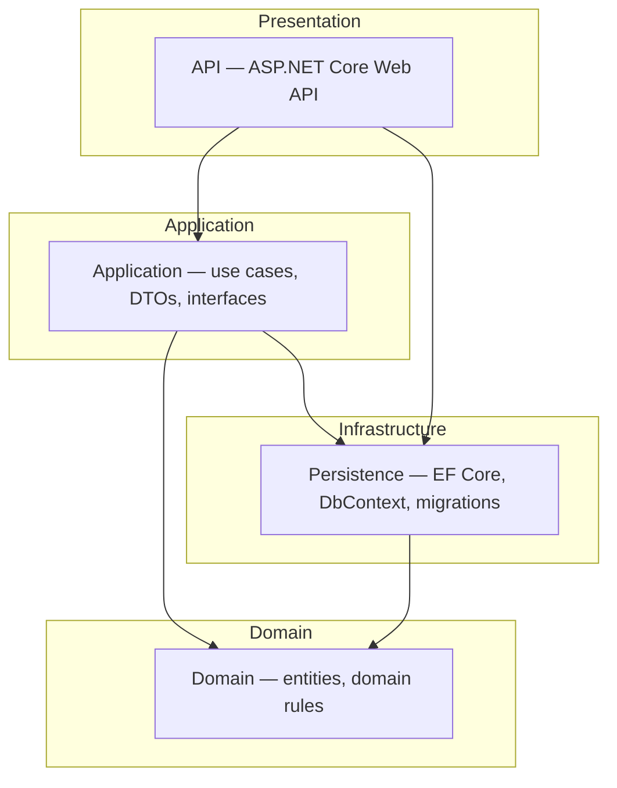

# Clean Architecture overview

EventsPlatform uses a **multi-project Clean Architecture** layout: each layer is a separate .NET project with strict dependency rules.

← [Docs index](../README.md) · Next → [Bootstrap reproduction](bootstrap-reproduction.md)

## Layer diagram



## The four projects

| Project | Layer | Responsibility | Depends on |
|---------|-------|----------------|------------|
| **Domain** | Core | Business entities (`Event`), domain invariants | Nothing |
| **Application** | Application | Use cases, commands/queries, DTOs, repository **interfaces** | Domain (target: only Domain) |
| **Persistence** | Infrastructure | EF Core `AppDbContext`, migrations, seeding, PostgreSQL | Domain |
| **API** | Presentation | HTTP entry point, DI wiring, `Program.cs`, controllers/endpoints | Application, Persistence |

## Dependency rule

**Dependencies point inward.** Outer layers may use inner layers; inner layers must never reference outer ones.

```text
API  ──►  Application  ──►  Domain
  │              │
  └──────►  Persistence  ──►  Domain
```

- **Domain** knows nothing about HTTP, EF Core, or PostgreSQL.
- **Persistence** knows how to *store* `Event`; it references Domain entities.
- **Application** orchestrates business operations (e.g. list upcoming events).
- **API** is the **composition root**: registers services and maps HTTP to application logic.

## What belongs in each layer

### Domain (`Domain/`)

- Entities: `Event.cs`
- Value objects, enums, domain events (future)
- Domain exceptions and business rules

**Does not contain:** DbContext, connection strings, controllers, DTOs.

### Application (`Application/`)

- Commands / queries (CQRS-style, future)
- DTOs for use cases (not HTTP-specific)
- Interfaces: `IEventRepository`, `IUnitOfWork` (future)
- Validation and mapping logic

**Currently:** placeholder only (`Class1.cs`). Logic will move here before the API grows.

### Persistence (`Persistence/`)

- `AppDbContext` — EF Core mapping to PostgreSQL
- `Migrations/` — versioned schema changes
- `DbInitializer` — seed data for development
- Concrete repository implementations (future)

### API (`API/`)

- `Program.cs` — DI, middleware, startup (migrate + seed)
- Controllers or minimal API endpoints (future)
- `appsettings*.json`, launch profiles
- `Microsoft.EntityFrameworkCore.Design` — design-time migrations only (PrivateAssets)

## Request flow (target, once API exists)

```text
HTTP request
  → API controller / endpoint
    → Application handler (e.g. GetEventsQuery)
      → IEventRepository (interface in Application)
        → EventRepository (implementation in Persistence)
          → AppDbContext → PostgreSQL
```

## Request flow (today)

```text
App startup (Program.cs)
  → Register AppDbContext + Npgsql
  → MigrateAsync()
  → DbInitializer.SeedData()
  → MapControllers() (WeatherForecast template only)
```

No Events HTTP endpoints yet; the database layer is wired and seeded.

## SOLID mapping

| Principle | How it shows up here |
|-----------|----------------------|
| **S** — Single responsibility | Each project has one reason to change |
| **O** — Open/closed | Add features via new handlers/repos, not by editing Domain |
| **L** — Liskov substitution | Repository interfaces swappable (in-memory vs EF) |
| **I** — Interface segregation | Small interfaces per aggregate (future) |
| **D** — Dependency inversion | API/Application depend on abstractions; Persistence implements them |

## Current vs ideal Application dependency

**Ideal:** `Application` → `Domain` only. `Persistence` → `Application` + `Domain` (implements interfaces).

**Current:** `Application` also references `Persistence` (early scaffold). When you add use cases, remove the Application → Persistence reference and register implementations from `API` instead.

## Folder map (source only)

```text
EventsPlatform-DotNet-React/
├── Domain/
│   └── Event.cs
├── Application/
│   └── Class1.cs              # placeholder
├── Persistence/
│   ├── AppDbContext.cs
│   ├── DbInitializer.cs
│   └── Migrations/
└── API/
    ├── Program.cs
    ├── appsettings.json
    ├── appsettings.Development.json
    ├── Controllers/           # template WeatherForecast only
    └── Properties/launchSettings.json
```

## Related docs

- [Bootstrap reproduction](bootstrap-reproduction.md)
- [EF Core & migrations](../02-data-layer/ef-core-and-migrations.md)
